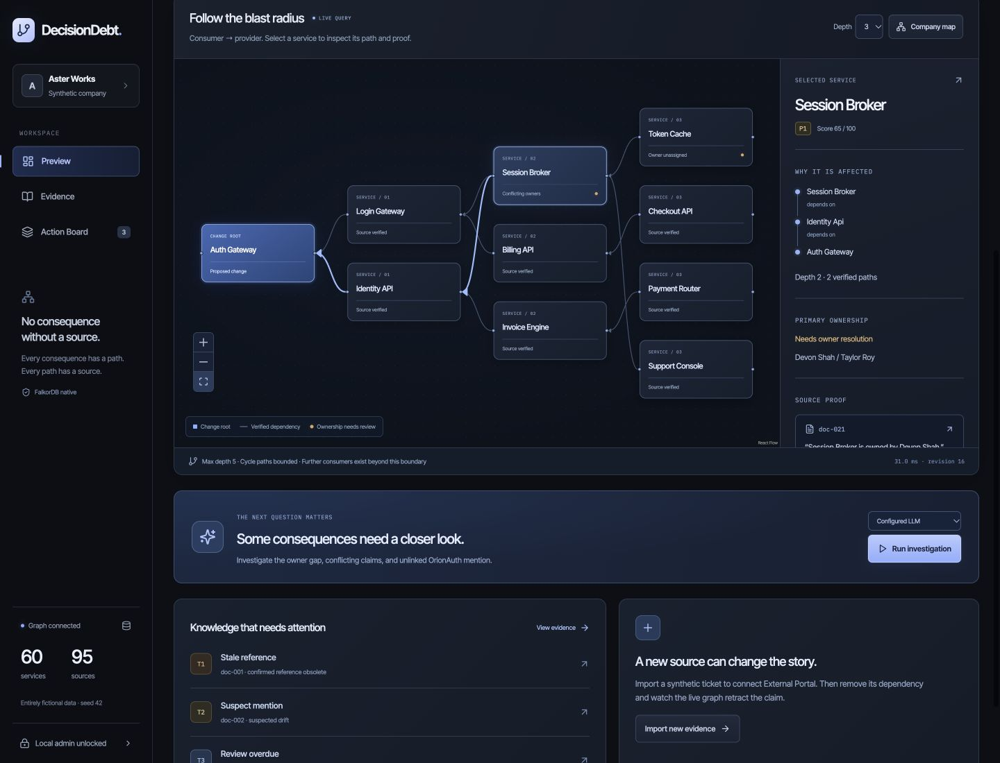
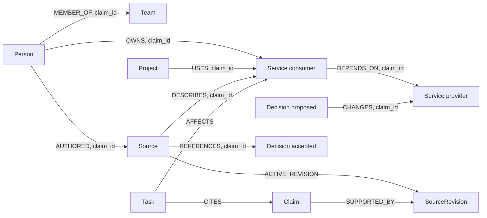

# DecisionDebt

**Know what a decision breaks before you make it**

**[Live demo](http://decisiondebt.52.202.25.181.sslip.io:8081/) · [Video](https://youtu.be/_9faaH35xPI) · [Public repository](https://github.com/himanshu748/decisiondebt)**

**Track: Company Brain (Track 03)** — WeMakeDevs x FalkorDB Graph Hacks

[](https://github.com/himanshu748/decisiondebt/actions/workflows/ci.yml)

DecisionDebt connects a company's people, teams, projects, documents and decisions in one source-backed graph. It shows which services and projects a proposed decision affects, and who needs to be involved. Its agent investigates missing or conflicting knowledge and proposes remediation drafts for a person to review before local approval.

**All Aster Works records are fictional.** The public demo is read-only and displays a recorded provider investigation; it makes no LLM calls. [Complete local setup](#run-locally) supports the protected import and approval workflows shown in the video.



## What runs here

- A real FalkorDB 6.0.2 stores dependencies, ownership, project usage, full-text source search, claims, revisions, decision lineage, draft tasks and investigation traces.
- A Python 3.12 FastAPI process parses raw Markdown, JSON tickets and JSONL chats, validates exact source spans, writes verified claims, and assembles live Cypher results.
- A Vite + React + TypeScript landing page at `/` introduces the product using live graph results. The studio at `/studio` presents Preview, Evidence, and Action Board. React Flow arranges backend-provided nodes and edges. The browser never computes a second impact graph.
- An optional OpenAI-compatible model chooses bounded tools. Without a supplied key, the product explicitly runs **Deterministic rule run**. The included genuine OpenRouter run covers all three ambiguity cases; the earlier deterministic trace is retained separately.

Initial measured import: **60 services, 8 teams, 24 people, 12 projects, 94 sources, 315 verified semantic edges, 4 candidates**. Canonical proposed preview: **12 services**, including a two-path diamond and a cycle, with three distinct drift tiers. See [recorded query results](evidence/query-results/initial-preview.json), [test output](evidence/test-results/pytest.txt), [precision/recall](evidence/test-results/precision-recall.json), [outage/persistence proof](evidence/test-results/lifecycle.json), and [browser checks](evidence/test-results/ui-smoke.json).

The demo imports an additional source, so a used local graph can have 95 sources and retained revision history. Re-importing the original corpus is idempotent and does not erase additional sources.

## Why Company Brain

The [Track 03 brief](https://www.wemakedevs.org/hackathons/falkordb#tracks) asks for connected company knowledge that an agent can use to answer questions and get work done. DecisionDebt maps that brief to these working paths:

- **One company graph:** people belong to teams, people own services and author sources, projects use services, and decisions change services. Documents, tickets and chats supply anchored claims. See the [graph model](#graph-model), [extractor](backend/app/ingest/extract.py) and [synthetic graph snapshot](evidence/deployment/graph-snapshot-20261016.json).
- **Answer a company question:** “What would replacing OrionAuth affect?” The [reverse multi-hop query](backend/app/graph/queries.py) finds services; connected project, owner and document queries add responsibility and review context. Inspect the [live preview](http://decisiondebt.52.202.25.181.sslip.io:8081/api/decisions/dec-auth-002/preview).
- **Trace the decision:** the [live decision lineage record](http://decisiondebt.52.202.25.181.sslip.io:8081/api/decisions) preserves the accepted predecessor, proposed successor and approval history. The proposal remains proposed; a `SUPERSEDES` edge is created only after separate acceptance. The [source-anchored preview receipt](evidence/query-results/initial-preview.json) records the intended comparison.
- **Turn evidence into work:** the [recorded agent trace](evidence/agent-traces/llm-run.json) investigates missing ownership, conflicting primary owners and an unlinked mention. The [action board](http://decisiondebt.52.202.25.181.sslip.io:8081/studio?tab=Action%20Board) presents its local drafts. The [recorded import/retraction](evidence/query-results/dynamic-import.json) shows how a new source changes the graph and its affected set.

The prototype answers bounded decision-impact and ownership questions. Team membership is stored as source-backed graph knowledge; general company chat and external ticket execution are outside its implemented scope.

## Run locally

Requires Python 3.12, Node 22 LTS/npm and a running Docker daemon. The host used for validation is Apple Silicon ARM64.

```bash
# Run from this repository.
./tools/db.sh                 # docker compose up -d db, or the documented Docker CLI fallback
python3.12 -m venv .venv
source .venv/bin/activate
pip install -r requirements.txt

# Set your own token. Never commit .env.
cp .env.example .env
python -c 'import secrets; print(secrets.token_urlsafe(32))'
# Replace ADMIN_TOKEN in .env with that random value.

python tools/generate_corpus.py --seed 42 --out data/synthetic
python tools/ingest.py --reset --dir data/synthetic/raw
python tools/smoke_falkordb.py
pytest -q

cd web
npm ci
npm run build
cd ..
uvicorn backend.app.main:app --host 127.0.0.1 --port 8000 --workers 1
```

Open [the landing page](http://127.0.0.1:8000/) or [the decision studio](http://127.0.0.1:8000/studio). FastAPI serves built assets on the same origin as `/api`. For separate frontend development, run `npm run dev -- --host 127.0.0.1 --port 5173` in `web/`; Vite proxies `/api` to 8000. Rebuild assets before using the single-origin server.

Create your own random local `.env` token using the setup commands above. Use it to unlock **Local admin** in the UI. It stays in browser memory and is sent only with explicit local write actions. Restarting the browser locks the UI again. The server checks the token on every write; the visual unlock alone is not authorization.

`--reset` deletes nodes only in the configured DecisionDebt graph, and is for a clean local fixture. Stop the API before CLI ingestion. Do not run multiple workers or simultaneous CLI/API writers. No command in this runbook pushes a remote or deploys infrastructure.

### Docker configuration

`compose.yaml` exposes only `127.0.0.1:16380:6379`, uses `decisiondebt-data:/data`, and enables `--appendonly yes --appendfsync everysec`. The local host has no Compose plugin, so `tools/db.sh` used an equivalent DB-only `docker run`. Container: `decisiondebt-db`. No unrelated containers were touched.

### Genuine LLM run and private key configuration

The owner approved reuse of the existing EmbodiWeave OpenRouter key in this project's ignored, mode-600 `.env`. The completed run used `nvidia/nemotron-3-super-120b-a12b:free`, with zero-price routing and provider fallback disabled. No credential is included in this repository or its evidence.

[The real trace](evidence/agent-traces/llm-run.json) and [proof audit](evidence/agent-traces/llm-proof.json) show **8 model turns, 11 tool calls, 51.6 seconds, 1,233 source characters, and $0 provider-reported cost**. All eight calls retain provider response IDs and actual model identity. [Investigation findings](evidence/LLM-INVESTIGATION.md) explain the three outcomes and retained failed attempts.

To reproduce with your own OpenRouter key, set these server-only values in `.env`, preserving `ADMIN_TOKEN`, then restart the API. A blank-key template is in [.env.openrouter.example](.env.openrouter.example).

```dotenv
DD_AGENT_MODE=llm
DD_LLM_BASE_URL=https://openrouter.ai/api/v1
DD_LLM_MODEL=nvidia/nemotron-3-super-120b-a12b:free
DD_LLM_API_KEY=your-supplied-key
```

For a Groq key, the same **`DD_LLM_API_KEY` field in `.env`** is the place to add it; also change the base URL to `https://api.groq.com/openai/v1` and choose a model available to your account (the spec's example is `openai/gpt-oss-120b`). Groq was not used for the recorded run. Keep keys out of chat, screenshots and source control.

Select **Configured LLM** in the studio and run the investigation, or call the protected local API once through:

```bash
.venv/bin/python tools/run_llm.py
```

The CLI saves `llm-run.json` only when provider identity, successful status, all three coverage cases and run limits pass. Incomplete attempts retain separate filenames. A mock never satisfies the proof gate. Missing ownership requires actual ownership inspection and an additional ticket/chat. Conflicting ownership requires both primary claim excerpts. The unlinked mention requires native obsolete-term search and source context. Ambiguous owners remain unassigned; mention evidence supports qualified document review or abstention.

A missing key returns `503 AGENT_PROVIDER_UNAVAILABLE`. HTTP 429 stops the run and records rate limiting. Requests have a hard total timeout in addition to the run's 90-second deadline. Only synthetic company evidence is sent. The recorded zero cost is an observed provider receipt, not a promise of future model availability or pricing. The zero-price caps apply to the OpenRouter `:free` route.

### Visual design

The redesign uses the requested `custom-design` guide and explicitly requested `motion-design` skill, with Motion for React, a shared precise easing curve, restrained page/tab/dialog transitions, once-only section reveals and reduced-motion guards. Manu Arora's [Aceternity sidebar](https://ui.aceternity.com/components/sidebar), [bento grid](https://ui.aceternity.com/components/bento-grid) and [background beams](https://ui.aceternity.com/components/background-beams) informed surface depth and hierarchy. The layout and code are original; no paid components were copied. The original generated concept artwork is bundled locally with its [prompt and provenance](web/public/assets/ASSETS.md). It is labeled as concept art, separate from live source evidence.

### Public read-only deployment

The [live deployment](http://decisiondebt.52.202.25.181.sslip.io:8081/) runs FastAPI plus built React assets and **FalkorDB 6.0.2** on the existing AWS Lightsail host, with separate `decisiondebt-public-api` / `decisiondebt-public-db` containers, graph `decisiondebt_public`, network and volume. Its own port is 8081. It uses HTTP so EmbodiWeave's existing HTTPS proxy, containers, ports 80/443 and graph remain untouched. Do not enter credentials into this public demo.

Public mode discards `ADMIN_TOKEN` and `DD_LLM_API_KEY` even if accidentally supplied, disables the provider, and returns 403 for every admin route and non-read request. Uvicorn trusts the direct peer address, not forwarded headers. API requests use per-peer and global token buckets with a bounded client map; overload returns 429 with `Retry-After`. The database has no published port. [Boundary tests](backend/tests/unit/test_public_mode.py), [public smoke results](evidence/deployment/public-smoke-20261016.json) and the [deployment receipt](evidence/deployment/receipt-20261016.json) record these checks.

The public graph is an unchanged synthetic snapshot of the locally recorded run and source history. Queries execute against its live FalkorDB; the provider trace is explicitly recorded evidence. [Snapshot export receipt](evidence/deployment/snapshot-export-20261016.json) identifies its hash and source revision. No provider credential or `.env` is in the image.

To reproduce this separate deployment locally with Docker Compose:

```bash
npm ci --prefix web
npm run build --prefix web
export DD_COMMIT=$(git rev-parse HEAD)
docker compose -f deploy/compose.public.yaml build api
docker compose -f deploy/compose.public.yaml up -d db
docker compose -f deploy/compose.public.yaml run --rm -T \
  -v "$PWD/evidence/deployment/graph-snapshot-20261016.json:/seed.json:ro" \
  api python tools/public_snapshot.py import /seed.json
docker compose -f deploy/compose.public.yaml up -d api
curl -fsS http://127.0.0.1:8081/api/health
python tools/smoke_public.py --url http://127.0.0.1:8081 \
  --output work/public-smoke.json --test-rate-limit
```

Seed only an empty `decisiondebt_public` graph; the importer refuses to overwrite existing state. The default separate volume persists across container restarts. Use `DD_BIND_ADDRESS=127.0.0.1` before Compose when keeping this instance local. The image's `/api/health` check validates the graph, public mode and disabled provider.

## The 90-second story

See [DEMO.md](DEMO.md) for exact actions and narration. The 90-second [demo](evidence/decisiondebt-demo.mp4) is an edited walkthrough of actual redesigned browser captures and the recorded genuine provider run. Its [capture manifest](evidence/demo-v2/manifest.json) retains source frame hashes and capture times. The [YouTube upload receipt](evidence/youtube/upload-20261016.json) records unlisted publication, the original file hash and verified English-caption playback. The [quality review](evidence/youtube/quality-review-20261016.json) records a 1280×960 source and YouTube playback currently capped at 720p; small dashboard text is a presentation limitation. The original continuous browser video remains in the archive, labeled as original UI and deterministic.

1. Preview `dec-auth-002` while it remains proposed. `dec-auth-001` stays accepted, with no `SUPERSEDES` edge until explicit acceptance.
2. Select Session Broker. Its two actual claim-backed paths form a diamond. Token Cache exposes a missing owner; Session Broker has competing primary owners.
3. Review T1 obsolete citations, T2 suspected mentions, and T3 overdue reviews. Search uses FalkorDB's native full-text procedure and rechecks exact text.
4. Inspect the recorded bounded provider investigation and its tool results, including rejected calls and corrections. Proposals remain local drafts and ambiguous owners remain unassigned.
5. Import a ticket: `External Portal depends on Billing API for customer identity verification.` A fresh Cypher preview includes External Portal. Update the same ticket to remove the assertion; only that source's support retracts.
6. Approve a local task through a separate confirmation dialog. This records an ApprovalEvent and changes only task state. The action board defaults to the latest analysis; All history retains earlier attempts.

## Why FalkorDB is load-bearing

FalkorDB performs reachability, connected project/ownership retrieval, source search and provenance joins. The browser arranges returned nodes; Python formats and validates returned rows. Runtime code has no fallback dependency traversal or cached impact answer. [Graph client](backend/app/graph/client.py) · [query templates](backend/app/graph/queries.py) · [impact assembler](backend/app/domain/impact.py).

| Product operation | Actual query and returned evidence | What breaks without FalkorDB |
|---|---|---|
| Proposed decision impact | Q1 resolves the decision's changed service; Q2 returns incoming paths up to five hops, service IDs, hop counts and claim IDs. | The product cannot compute the affected set, path explanations, priorities or traversal boundary. |
| Company responsibility | Q3 returns projects using affected services; Q4 returns primary-owner claims. | Project scope, owner gaps and conflicting-owner investigations cannot be computed. |
| Source-backed answers | Q5 joins Claim → SourceRevision; Q6 joins Source → old Decision; Q7 performs native full-text retrieval; Q8 joins documents to affected services. | Exact-source inspection, stale-citation detection, obsolete-term search and linked review findings fail. |
| Work and decision history | Task → Service / Claim links, AgentRun records, Decision lineage and ApprovalEvent records are stored in the graph. | Saved drafts, investigation history and approval/lineage reads are unavailable. |

These are the product's actual Cypher templates, rather than substitute demonstration queries:

```cypher
// Q2: incoming dependency paths, including each relationship's Claim ID.
MATCH p=(consumer:Service)-[:DEPENDS_ON*1..5]->(root:Service {id:$root_id})
RETURN consumer.id AS service_id,length(p) AS hops,
       [n IN nodes(p) | n.id] AS service_path,
       [r IN relationships(p) | r.claim_id] AS claim_path
ORDER BY hops,service_id
```

```cypher
// Q3: projects connected to the multi-hop affected set supplied by Q2.
MATCH (p:Project)-[u:USES]->(s:Service) WHERE s.id IN $affected_ids
RETURN DISTINCT p.id AS project_id,p.name AS name,
       s.id AS via_service,u.claim_id AS claim_id
ORDER BY project_id,via_service
```

```cypher
// Q5: recover exact provenance for a claim returned along an impact path.
MATCH (c:Claim {id:$claim_id})-[:SUPPORTED_BY]->(r:SourceRevision)
RETURN properties(c) AS claim,r.source_id AS source_id,
       r.sha256 AS source_sha256,r.body AS source_body,r.raw_text AS source_raw_text
```

The [deployed outage receipt](evidence/deployment/receipt-20261016.json) records a deliberate stop of only `decisiondebt-public-db`: preview, company summary and agent-history reads returned **503 `GRAPH_UNAVAILABLE`**. Restart restored the same graph revision. EmbodiWeave's container IDs and start times stayed unchanged during that outage test. The [isolation review](evidence/deployment/isolation-review-20261016.json) records that its containers changed between the earlier preflight and that test; the cause was not established by these checks. The earlier [local outage/persistence result](evidence/test-results/lifecycle.json) is retained separately.

## Graph model



Every semantic edge carries a verified Claim ID. The Claim stores subject, predicate, object, source ID, source revision, exact start/end offsets, anchor field, excerpt, extraction method and status. SourceRevision retains normalized original text and parsed body. Metadata claims anchor to raw front matter/JSON; relation claims anchor to parsed body. Updating one source retracts only its claims and parallel claim-specific edges, preserving independent support.

### Important queries

All reads use official-client `g.ro_query`, with bound parameters. Trusted writes use `g.query`.

```cypher
// Reverse impact: consumer points toward provider, maximum 5 relationships.
MATCH p=(consumer:Service)-[:DEPENDS_ON*1..5]->(root:Service {id:$root_id})
RETURN consumer.id AS service_id, length(p) AS hops,
       [n IN nodes(p) | n.id] AS service_path,
       [r IN relationships(p) | r.claim_id] AS claim_path
ORDER BY hops, service_id
```

```cypher
// Tested index syntax on this image. See DECISIONS.md for the procedure mismatch.
CREATE FULLTEXT INDEX FOR (s:Source) ON (s.title,s.body)
CALL db.idx.fulltext.queryNodes('Source',$safe_query)
YIELD node,score
RETURN node.id AS source_id,node.title AS title,score
```

```cypher
MATCH (p:Person)-[o:OWNS]->(s:Service {id:$service_id})
RETURN p.id AS owner_id,o.role AS role,o.claim_id AS claim_id
```

The backend deduplicates result rows, preserves three sorted supporting paths and reports the total alternatives. It does not run its own dependency traversal. A separate one-edge query discloses consumers beyond the depth-five boundary. The current canonical case is **truncated**, not an unlimited blast radius.

The UI includes template names, Cypher, bound parameters, actual revision, row counts and measured timings. GET preview never stores findings or an AgentRun. POST acceptance creates human approval lineage separately.

## Verify and inspect

[GitHub Actions](https://github.com/himanshu748/decisiondebt/actions/workflows/ci.yml) starts the pinned FalkorDB service, builds the frontend, runs pytest including real DB outage/restart, and runs Chromium UI smoke at desktop and mobile sizes. [Successful CI receipt](evidence/ci/run-38896361671.json) · [CI test output](evidence/ci/38896361671/pytest.txt) · [New local test run](evidence/submission-ready-20261016/pytest-full.txt). The new runs report **46 passed**; the earlier 42-test results remain unchanged in their original evidence files.

```bash
pytest -q
# Full availability test, local API must be running:
DD_TEST_LIFECYCLE=1 pytest -q
# Write a new audit without replacing historical evidence:
python tools/verify_submission.py --output work/verification-report.json
# Use --test-log PATH when auditing a new separately labeled pytest run.
# Requires running local API; deliberately stops and restarts ONLY decisiondebt-db:
python tools/check_lifecycle.py
```

Tests use the separate `decisiondebt_test` graph. The oracle lives under `tests/fixtures/` and independent BFS lives in `tests/oracle.py`. Runtime code cannot read the oracle. Precision/recall is evaluated against generator truth; it does not prove performance on arbitrary company documents. Mocked provider choices exercise tool selection and guardrails, and are labeled as tests, not real provider evidence.

The extractor recognizes explicit supported language. Negated, hedged, unresolved aliases and unsupported statements do not become facts. Optional model-assisted extraction and reviewer confirmation are not implemented; candidate claims remain visible and inactive. The optional confirmation endpoint was deliberately omitted rather than auto-accepting uncertainty.

## Limits and remaining gates

- The real provider run is verified locally; provider availability and quota can change. Earlier failed attempts remain recorded as incomplete.
- Local single-process locking only. A process crash mid-import may require rerunning ingestion; no distributed transaction guarantee.
- Source deletion is expressed as a new content revision without the old assertion; directory sync/deletion detection is outside scope.
- General language parsing is deliberately bounded. Full-text has an 80-hit review cap and search APIs return at most 20 records; search score is not certainty.
- Review-date parse failures are not automatically overdue. Default analysis clock is `2026-10-15T12:00:00+05:30`; a timezone-aware `as_of` can be provided.
- Browser checks cover Chromium at 1440 px and 375 px, not every browser/device. Fonts use Google Fonts and degrade to sans-serif offline.
- The public read-only deployment and unlisted YouTube upload are linked above. No release, hackathon form submission or external business ticket/email operation was performed.

## AI coding disclosure

Codex generated most of the implementation, tests and styling, along with the synthetic fixture, documentation and browser automation. Automated verification and the recorded provider run are linked evidence; they do not establish that the participant personally verified or understands the implementation. The participant must complete the following fields truthfully before submitting under [Rules 11–13](https://www.wemakedevs.org/hackathons/falkordb/rules).

### What I designed

TODO: Describe only the graph model, node/edge types and drift tiers you personally designed or materially changed. Identify the relevant code or commit; do not claim generated design as your own.

### Decisions I made

TODO: Identify the decisions you personally made and why. Link the relevant entries in [DECISIONS.md](DECISIONS.md#measurement-backed-log), [frozen choices](DECISIONS.md#frozen-choices) or [real-run corrections](DECISIONS.md#real-run-corrections-and-outcome). Those implementation records alone do not establish participant authorship.

### What I verified myself

TODO: Record the workflows and queries you personally ran, what you checked in their sources/results, and what you learned. Link your own dated evidence. Codex's [CI](evidence/ci/run-38896361671.json), [deployment smoke](evidence/deployment/public-smoke-20261016.json) and [outage receipt](evidence/deployment/receipt-20261016.json) remain automated verification.

### What Codex generated

Codex generated most of the implementation, tests and styling. TODO: Review and complete the scope of generated work, including fixture data, documentation, UI, agent integration, deployment/CI configuration and video editing, and identify any portions you subsequently rewrote.

The remaining owner actions are to complete these contribution/verification fields honestly and submit the [submission draft](docs/submission.md) through the event form before **October 18, 2026, 11:59 PM IST**. No form has been submitted by this automation.

Official references: [FalkorDB Python client](https://github.com/FalkorDB/falkordb-py), [full-text documentation](https://docs.falkordb.com/cypher/indexing/fulltext-index), [event rules](https://www.wemakedevs.org/hackathons/falkordb/rules). Test results here, not those reference pages, establish this repository's measured behavior.
